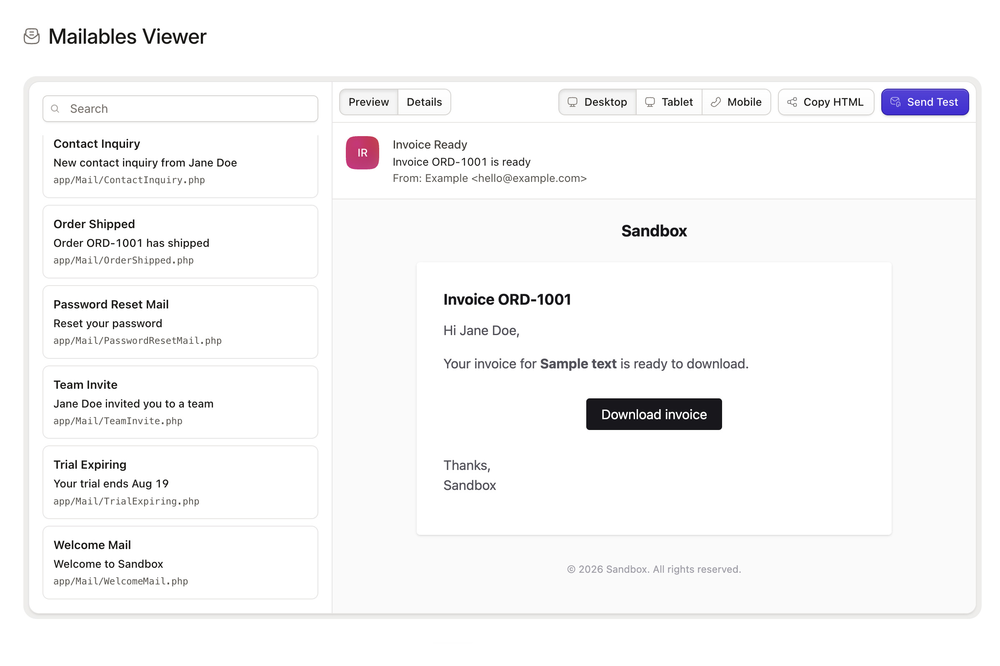

<!-- statamic:hide -->
# Mailables Viewer

> Preview Laravel mailables from the Statamic Control Panel.


<!-- /statamic:hide -->

## Features

- Discovers concrete `Illuminate\Mail\Mailable` classes in `app/Mail`
- Renders a live HTML preview
- Injects sample constructor data (scalars, Eloquent models, Statamic users/entries/forms)
- Lets you edit strings, numbers, bools, and datetimes and see the preview update
- Shows subject, from, attachments, template, queue status, and where the mailable is referenced
- Sends a test email with `sendNow()`
- Opens a chosen mailable directly via `?mailable=`
- Previews and sends in any site of a multisite install

## Installation

You can install the Mailables Viewer addon via Composer:

```
composer require statamic/mailables-viewer
```

Then visit **Utilities → Mailables** in the Control Panel. Super users see it automatically. Everyone else needs the `access mailables utility` permission.

## Usage

Any concrete mailable in `app/Mail` is discovered automatically.

Register mailables that live elsewhere:

```php
use Statamic\MailablesViewer\Mailables;

Mailables::register(\App\Mail\Billing\InvoiceReady::class);
```

You can pass a class or an array of classes. The `Mailables` facade is also available as a Laravel alias.

### Linking to a mailable

Add `?mailable=` to the utility's URL to open the viewer with that mailable already selected:

```php
cp_route('utilities.mailables', ['mailable' => \App\Mail\OrderShipped::class]);
```

Useful for a "preview this email" button elsewhere in the Control Panel. A class the viewer does not have falls back to the first mailable in the list.

### Multisite

On a multisite install the viewer opens in the site selected in the Control Panel. The site dropdown, shown when you can access more than one site, reloads the viewer in that site: mailables are built, previewed and sent with the app locale set to the site's `lang` and with the site as the current one, so translations, globals and tags resolve in that site.

Add `?site=` to link to a site. It combines with `?mailable=`:

```php
cp_route('utilities.mailables', ['site' => 'french', 'mailable' => \App\Mail\OrderShipped::class]);
```

A site you cannot access, or one that does not exist, falls back to the selected site. Without access to any site the viewer answers 403. Single-site installs are unaffected.

### Constructor data

The viewer instantiates each mailable with sample values so you can preview it without writing a factory.

| Type | What happens |
| --- | --- |
| `string`, `int`, `float`, `bool`, datetimes | Fake sample values you can edit in Details |
| Statamic `User`, `Entry`, `Form`, `Submission` | First available record |
| Eloquent models | Factory `make()`, then `query()->first()`, then `::make()` |
| Anything else | Resolved from the container |

Objects and arrays stay read-only. Edit a scalar and the preview plus envelope (subject, from, attachments) refresh live.

Sample strings are guessed from the parameter name (`email` → `preview@example.com`, `name` → `Jane Doe`, `url` → `https://example.com`).

### Sending tests

Pick a mailable, optionally tweak the editable values, enter an address, and send. Tests use `sendNow()` so queued mailables still go out immediately.

## Requirements

- PHP 8.2+
- Statamic 6
